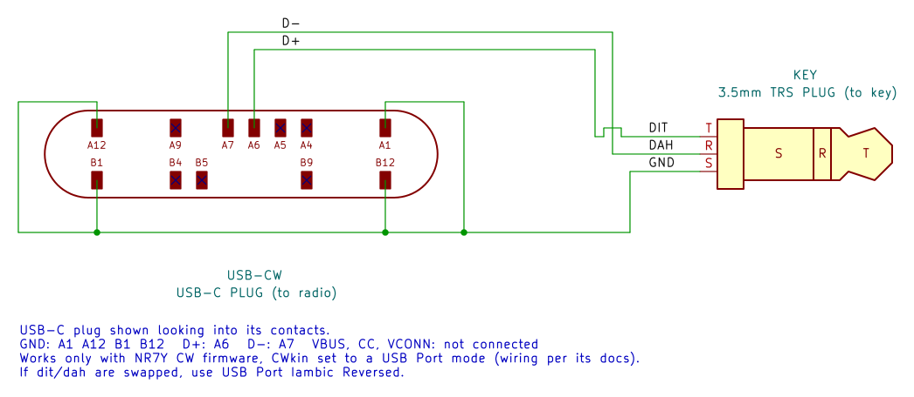
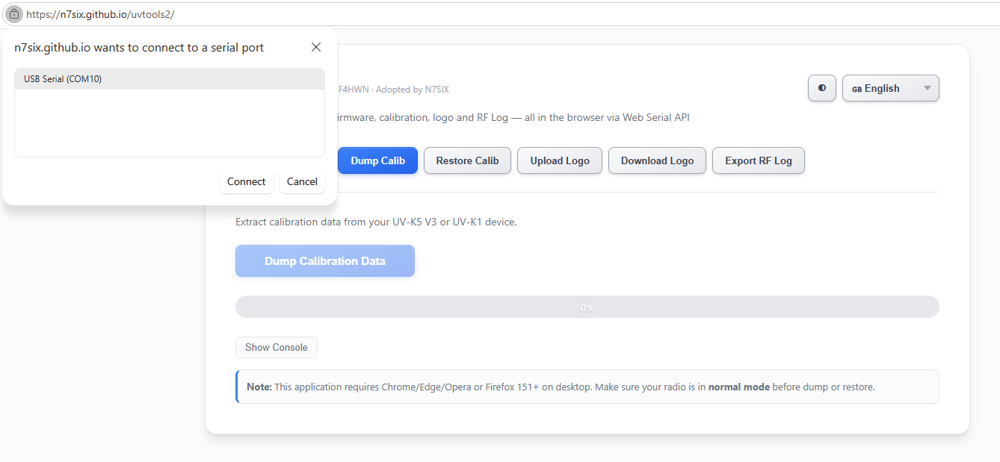
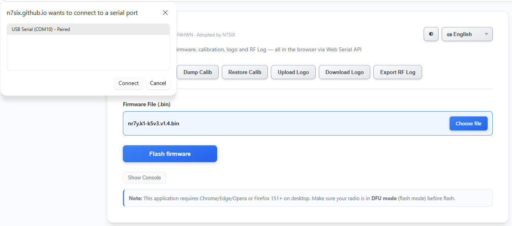
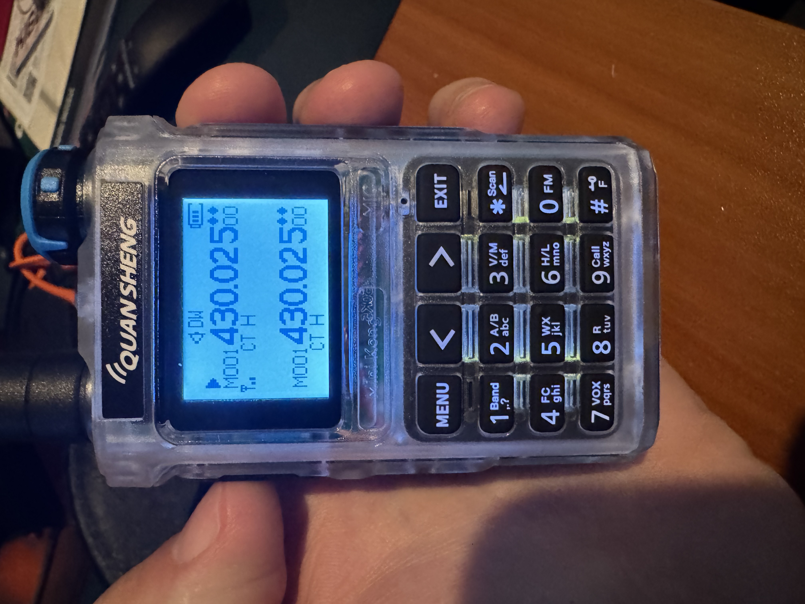
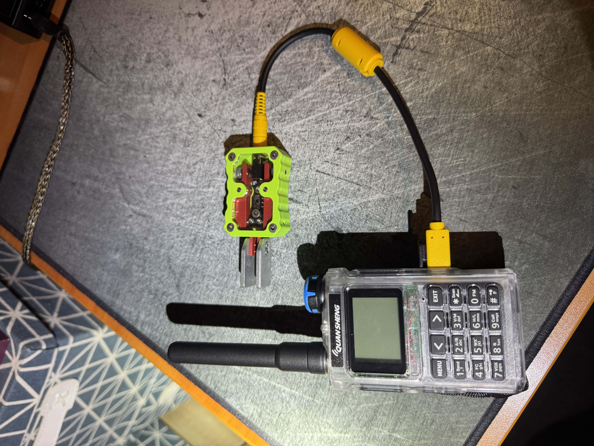

There's been quite a buzz in the last few months in the HAM community about operating CW from a cheap HT.  A great place to catch up on all of it would be [episode 274 of the Ham Radio Workbench](https://www.hamradioworkbench.com/podcast/hrwb-274-cw-on-a-fm-ht-with-brian-nr7y) with Brian NR7Y.  He talks through the modified firmware for the Quansheng HTs that support CW.  

While firmware has been around for a while for the UV-K5 that would let you plug in a key and do CW - it previously required some minor hardware modifications to the HT.  Given these are generally $30 HTs it's a pretty low risk thing and just as I was looking to get one to give it a try - Brian and others discovered that newer versions of the UV-K5 (v3) and the UV-K1 (minikong) actually have extra pins connected to the USB-C connector on the HT.  The original UV-K5 (v1) only has power connected to the USB-C.  What this meant was he was able to update the modified firmware for the K1 in particular to allow a paddle or key to be plugged straight into the USB-C port with no hardware modifications to the HT required.  Pretty cool!

 

 You can make something like this up easily enough - or there are now two options available to purchase something too.  The [KI6CR Labs adapter](https://www.ki6cr-labs.com/shop/quansheng-usb-adapter/) or the [digirig cable](https://digirig.net/product/usb-cw-key-cable/).  

 With either something made or something purchased - all you need to do is then flash your radio.  I bought a UV-K1 after listening to the HRWB ep linked above that talks through the differences.  One thing I missed was for the flashing process you need to use a normal HT programming cable (that plugs into the mic/speaker ports) and not just a USB-C to USB-C cable.  

 Start by having a read of the [NR7Y page](https://briand.github.io/cw-firmware-docs/) which is a great source of information on the firmware mod.  Make sure you understand the version of the HT you have so you flash the right thing.

 From there it's like most web flashers now-days.  I used the [N7SIX](https://n7six.github.io/uvtools2/) tool.  I plugged my radio in (not in DFU mode) to dump the calibration data incase I need it in the future.   I hit the Dump Calib button, selected my radio and saved the file off when done:

 

It was now time to flash the new firmware.  I had downloaded the right firmware file from the NR7Y page above.  I put my HT into DFU mode by holding down the PTT button while powering on (the LED on top of the HT will be on and the screen will be blank) and plugged it in.  On the N7SIX page I selected the Flash Firmware button, selected the firmware file I had already downloaded and hit Flash Firmware.  I picked my HT in DFU mode and the LED began to blink as it flashed the new firmware.

 

Once complete, I unplugged and restarted the HT.  The last step was to set the HT mode to CW, and set the "CWkin" to USB Port Iambic (as that what I was using) and I was off too the races!  You do need to put the radio back into "FM" mode if you want to program it again according to the docco.

 

 